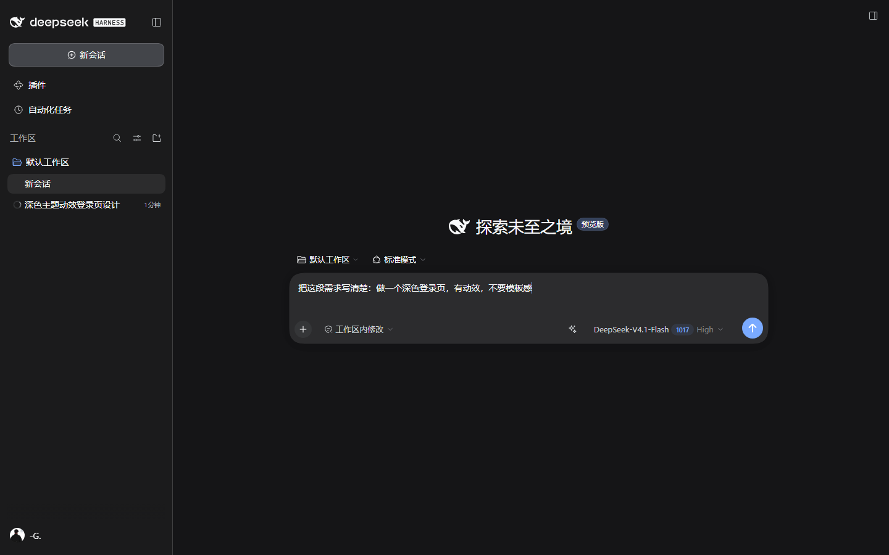
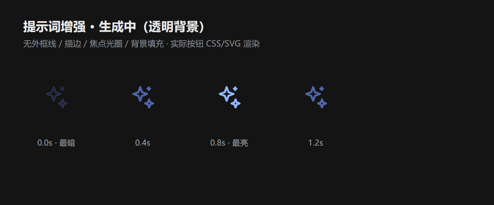
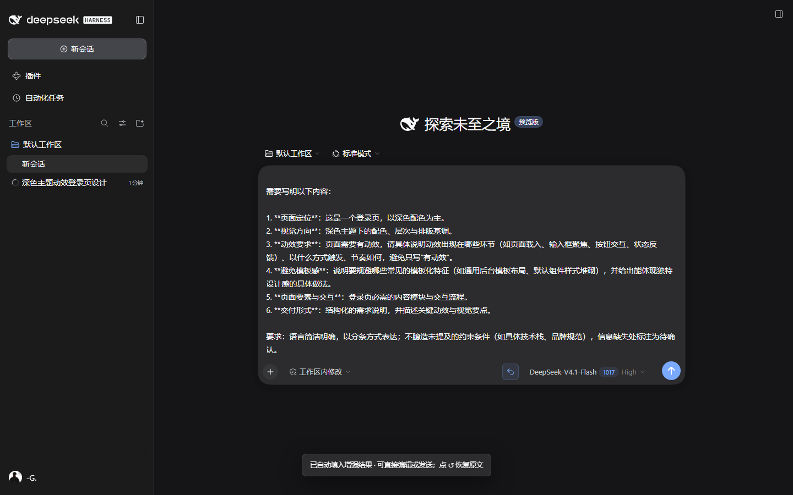

# dsh-prompt-enhance · 提示词增强

给 DeepSeek Harness 的会话输入框加一个「提示词增强」按钮：点一下，把随手写下的原始内容交给当前默认模型改写成更清晰、具体、结构完整的提示词，**直接自动填入输入框**；按钮随即变成「撤回优化」，点一下即可恢复增强前的原文。

**1.3.0 起支持结合会话上文**：增强时会先读当前会话最近的对话，理解「刚才那个方案」「上一条说的那个」这类指代，让改写结果与上下文语义连贯；但上下文只用来理解意图，**不会改变原始内容的主要表达意思**。

**1.4.0 起深度理解上一条消息**：把最后一条消息单独标为「上一条消息（重点）」并放宽到 4000 字，先解析它的具体内容（目标、方案步骤、约束、结论、专有名词、文件路径、参数），再判断当前输入与它的关系（承接 / 补充 / 修正 / 无关），然后把指代替换成上一条消息里的**具体内容**，让改写结果脱离对话也能直接执行。

**1.5.0 起严格执行字数上限**：不再放任长输出。字数上限按原始输入长度计算（150～800 字，含标点），并在三层强制：① 提示词里写死上限；② 超限自动做一次「压缩重写」；③ 压缩后仍超限则按句末硬截断。上一条消息的展开只能占用这个额度，不得突破。



## 交互

1. 在输入框写下内容，点模型选择器左边的 ✨。
2. 生成期间按钮保持 ✨，进入忽明忽暗的闪烁；再点一次可取消。
3. 生成完成后，结果自动填入输入框并聚焦在末尾，可以直接编辑或发送；用上会话上文时 toast 会标注「（已结合上文）」。
4. 按钮同时变成「撤回优化」↺：点击恢复增强前的原文。
5. 一旦你编辑、清空或发送了输入框内容，按钮自动回到 ✨（撤销记录失效），保证按钮状态与输入内容一致。

| 状态 | 按钮 | 说明 |
| --- | --- | --- |
| 空闲 | ✨ | 有内容时可点；空输入只提示 |
| 生成中 | ✨ 闪烁（无边框 / 透明底） | 再点 = 取消；图标在明暗之间循环，不显示外框线和背景 |
| 已填入 | ↺ | 仅在输入框内容仍等于刚填入的增强结果时显示 |



> 上图为按钮动画预览（实际 CSS/SVG 渲染的 4 个相位），不是整页截图；生成中按钮不显示外框线、描边、焦点光圈和背景填充。



## 设计细节

- **动画**：生成中 ✨ 以 1.6s 周期在 0.3～1 不透明度之间循环（叠加轻微亮度变化），形成持续闪烁；不旋转、不位移、不再额外发光。按钮采用无边框 + 透明背景设计：去掉外框线、描边、焦点光圈和背景填充，悬停/按下也不出现底色；尊重 `prefers-reduced-motion`，系统开启减少动态效果时静止显示 ✨。
- **自动填入**：使用宿主官方 `inputActions.setDraft()`，不绕过编辑器、不接管发送链路；发送仍走原来的 Enter / 发送按钮。
- **引用芯片**：增强前的草稿按 `text + references` 结构化快照保存，增强结果里能对上原引用文本时仍写回结构化草稿，文件/文件夹/会话芯片不会降级；点 ↺ 撤回同样还原芯片。模型把引用文本改写掉时，该引用降级为纯文本，绝不按旧位置硬还原。
- **状态联动**：撤销图标由「当前草稿是否等于刚填入的增强结果」推导，不是独立的开关。编辑、清空、发送、切换会话都会让按钮回到 ✨；切换会话还会中止在途请求。
- **不抢改动**：生成期间如果你继续编辑，结果不会覆盖新内容，只提示“输入内容已变化，本次结果未填入”。
- **语言与内容**：跟随输入语言；代码、命令、路径、URL、`@` 引用、`/` 命令、变量名、数字与特殊符号原样保留；不编造用户没提供的信息。
- **会话上文（1.3.0）**：增强前用 `sessionQuery.observeSession(sessionId)` 读当前会话事件流，只取**真人用户消息 + 助手可见正文**（最多 6 条、总计 9000 字），系统注入的 runtime-context / time-context / agent-instructions 快照一律排除；助手消息丢弃 reasoning，只留正文。读不到会话（无 sessionId、服务缺失、抛错）时自动退化为「无上下文」增强，功能照常可用。
- **重点上一条（1.4.0）**：最后一条消息标为「上一条消息·用户/助手（重点）」，篇幅上限放宽到 4000 字（较早消息仍 1200 字），保证其中的文件路径、行号、函数名、参数等细节不被截掉。
- **主意思不变**：带上下文时 system 提示按固定顺序工作——先解析上一条消息的具体内容，再判断当前输入是承接/补充/修正/无关，然后只把指代替换成具体内容；无关时忽略上下文；**不得改变原始内容的主要表达意思**，不新增原文没要求的需求。
- **字数上限（1.5.0）**：`computeOutputLimit(输入字数)` = `clamp(round(len × 1.5) + 80, 150, 800)`。上限是硬约束，按三层执行：提示词里写死「不得超过 N 字」→ 超限时用专用压缩提示词重写一次 → 仍超限则 `hardTrimToLimit` 按句末/标点硬截断并补省略号。响应里的 `limit` / `compressed` / `trimmed` 让客户端能如实提示。
- **展开也受限**：深度理解上一条消息时，指代展开只能占用同一份字数额度；能一句话说清就不写两行，不得以「要展开」为名突破上限。
- **模型**：使用 profile 的默认模型（`agentDefaultModel.currentSelection()`），与本机新建会话一致。

## 边界处理

| 场景 | 行为 |
| --- | --- |
| 空输入 / 只有空白 | 按钮可点，但只提示「先输入内容」，不发请求 |
| 超长输入（> 20000 字符） | 客户端先拦下并提示当前字符数；宿主端有同样的硬上限，绝不静默截断 |
| 输出超过字数上限 | 先自动压缩重写一次；仍超限则按句末硬截断并补省略号，`trimmed=true`，toast 提示「已按 N 字上限精简」 |
| 特殊字符 / 多行 / Markdown | JSON 传输 + React 纯文本渲染；换行、`<b>`、反斜杠路径等原样保留 |
| 生成中 | ✨ 闪烁（无边框 / 透明底）；再次点击取消（中止 fetch 与上游模型请求） |
| 生成期间草稿被改动 | 不自动填入，提示重试；草稿不受影响 |
| 模型/网络失败 | 底部 toast 显示具体错误，草稿保持不变 |
| 填入后手动编辑/清空/发送 | 撤销图标自动消失，回到 ✨ |
| 引用芯片 | 增强结果仍包含同一引用文本时保留文件/文件夹/会话芯片；被模型改写掉的引用降级为纯文本；图片/文件附件不受影响 |
| 模型输出被截断（达到输出上限） | 不填入半截结果，toast 提示「请缩短输入后重试」 |
| 超时 | 宿主 120s 中止上游请求，返回 504；客户端 135s 兜底 |
| 宿主没有默认模型 / 路由未注册 | 返回明确的 `NO_MODEL` / 网络错误提示 |

## 安装

### 方式一：dsh 插件命令（推荐）

```bash
dsh plugin --profile desktop add link:F:/开发/dsh-prompt-enhance/plugins/dsh-prompt-enhance
```

命令会把依赖写进 profile、并把声明了 `dsh.bundle` 的包自动并入 `dsh.profile.bundles`。

- **Host 半侧**：运行中的 profile 会由 HMR 自动重构，路由立即注册（`GET /dsh-prompt-enhance/status` 返回 `401` = 路由已注册，`404` = 未加载）。
- **浏览器半侧**：前端插件清单在页面加载时组装，装完或更新后请 **刷新页面（Ctrl+R）**。

### 方式二：手工挂载

1. 在 profile 的 `node_modules` 下建立目录联接：

   ```cmd
   mklink /J "%USERPROFILE%\.dsh\profiles\desktop\node_modules\dsh-prompt-enhance" "F:\开发\dsh-prompt-enhance\plugins\dsh-prompt-enhance"
   ```

2. 在 `%USERPROFILE%\.dsh\profiles\desktop\cordis.patch.yml` 末尾追加：

   ```yaml
   - insert:
       - id: dsh-prompt-enhance
         name: dsh-prompt-enhance
   ```

3. 刷新页面；必要时重启 DeepSeek Harness。

> 不要在 profile 的 `cordis.patch.yml` 里重复插入已经由 `dsh.profile.bundles` 选中的条目，否则同一路由会注册两次而报错。

## 结构

```
dsh-prompt-enhance/
  package.json           dsh.bundle / dsh.client 声明
  cordis.patch.yml       bundle 层：插入 Host 插件
  lib/index.js          Host 半侧：HTTP 路由 + ctx.llm 流式改写
  lib/context.js        Host 半侧：会话上文抽取（纯函数，零依赖）
  lib/client.js          浏览器半侧：按钮 + 自动填入 + 撤回（手写 ModuleLoader bundle）
  test/smoke-host.mjs    Host 逻辑冒烟测试（无依赖，node 直接跑）
  test/context.test.mjs  会话上文抽取单元测试
  test/context-mutation.mjs  反向插桩：破坏实现确认测试会失败
  test/client-draft.test.mjs  引用芯片映射纯函数测试（Node vm 直接跑 bundle）
  test/client-ui.test.mjs     按钮组件集成测试（增强填入 / 撤回 / 结构化降级回退）
  docs/                  截图
```

## 接口

| 方法 | 路径 | 说明 |
| --- | --- | --- |
| `GET` | `/dsh-prompt-enhance/status` | 诊断：插件版本、默认模型、输入/输出上限 |
| `POST` | `/dsh-prompt-enhance/enhance` | 请求体 `{ text, sessionId? }`，返回 `{ ok, text, unchanged, model, finish, limit, compressed, trimmed, elapsedMs, context }` |

`limit` / `compressed` / `trimmed`（1.5.0 新增）：本次字数上限、是否触发过压缩重写、是否最终用了硬截断；保证 `text` 的字符数一定 ≤ `limit`。

`context` 字段回报本次是否用上了会话上文：`{ used, previousRole, previousText, previousLength, blockChars, messageCount }`（1.4.0 增加 `previousLength` / `blockChars`，便于核对上一条消息与上下文块的实际体量）。

传 `sessionId` 时 Host 会读该会话最近对话作为改写参考；不传或读取失败时 `context.used` 为 `false`，走无上下文增强。

两条路由都会先经过宿主 `connection.requestRejection()` 的浏览器信任栅栏；只监听本机回环地址。

Host 侧不 import 任何 `@deepseek-ai/*` 包，只使用 `ctx.llm.stream` 的公开协议（`text-delta` / `finish`），避免第三方插件的模块解析差异。`sessionQuery` 按软依赖处理：不在 `inject` 里声明，缺失时上下文退化为空。

## 验证

```bash
node test/smoke-host.mjs
node --test test/context.test.mjs
node test/context-mutation.mjs
```

`context.test.mjs` 覆盖会话上文抽取：只认真人输入（排除 runtime-context / time-context / agent-instructions）、只取 text 块、丢弃 reasoning、按 seq 排序、取上一条、取最近 N 条、超长从中间省略、渲染角色标签、无对话时 `used=false`、非法输入安全。

`context-mutation.mjs` 是反向插桩：逐个破坏上述逻辑（不过滤系统注入 / 混入 reasoning / 取第一条而非最后一条 / 不截断 / 不排序），确认每个变异都会让测试失败，防止假绿。当前 5 个变异全部被抓。

`smoke-host.mjs` 额外覆盖会话上文的宿主集成：上下文进入 user 消息、system 切到带上下文版本、`context.used` 回报、无 sessionId 不读会话、sessionQuery 缺失或抛错时优雅降级、系统快照消息不进上下文。

端到端在隔离 profile（独立端口 + 无头 Chromium + 真实 `deepseek-official` 模型）验证过 1.3.0：

- 建立一轮对话后输入「就按刚才那个方案改一下，加个暗色模式」，点 ✨ → 自动填入「就按刚才那个**登录页**方案改一下：在保持现代简洁风格的前提下，新增暗色模式…」——「刚才那个方案」被上文解析为具体指代，主意思未变；
- 同一句话不传 sessionId 时 `context.used=false`，结果保留悬空的「刚才讨论确定的方案」，不会凭空补全；
- toast 显示「已自动填入增强结果（已结合上文）」；点 ↺ 恢复原文并提示「已恢复优化前的内容」；
- 直接调接口对照：带 sessionId 返回 `context.used=true`、`messageCount=6`、`previousRole=assistant`。

## 已知限制

- 撤销图标只在输入框内容仍等于刚填入的增强结果时出现；一旦手动编辑，本次撤销记录即失效（避免覆盖你的修改）。
- 引用芯片按引用文本精确匹配重定位：模型把引用文本改写掉、拆开或换序时会降级为纯文本，不会猜位置；附件 id 不受影响。
- 增强结果使用默认模型，不读取当前会话里临时切换的模型；如需固定其它模型，可在 Host 侧改 `readDefaultRoute()`。
- 会话上文只取最近 6 条真人对话、总计 9000 字，更早的上下文不参与；较早单条超 1200 字、上一条超 4000 字时从中间省略。
- 子代理（subagent）会话的输入来自 mnemon 委派内容时，其 `source.kind` 仍是 `user`，会被当作真人消息纳入上下文；这是上游事件标注的既有限制。
- 首次进入会话若要立刻用上下文，请确认该会话已经至少有一轮问答；空会话会自动退化为无上下文增强。
