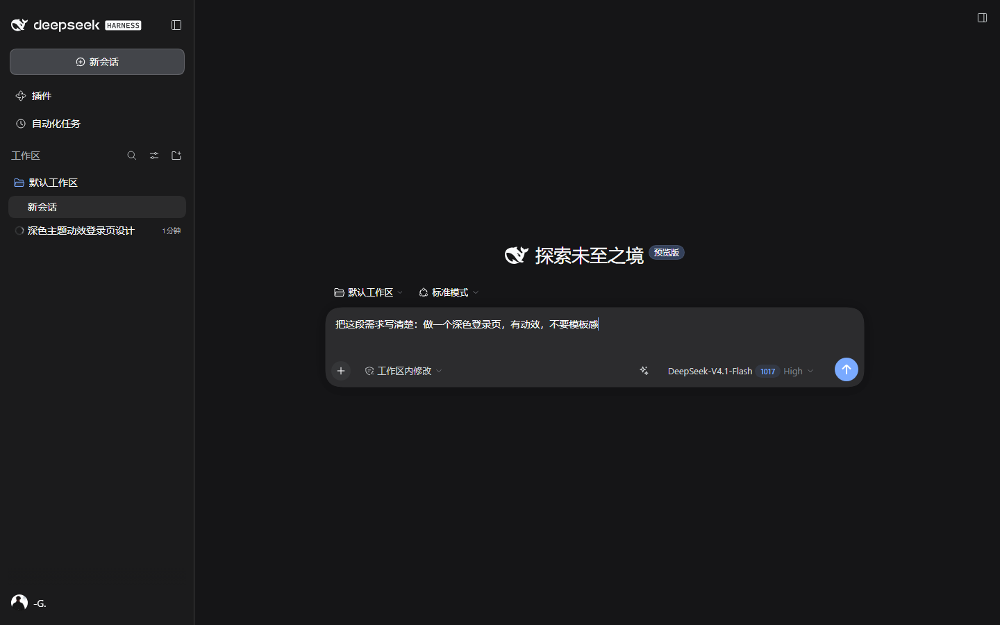
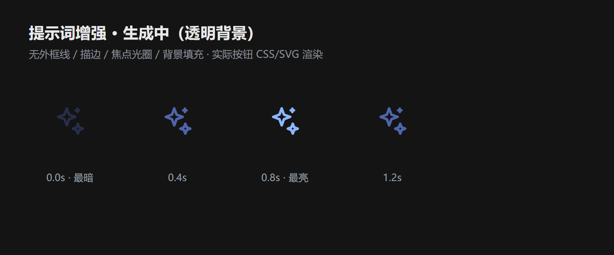
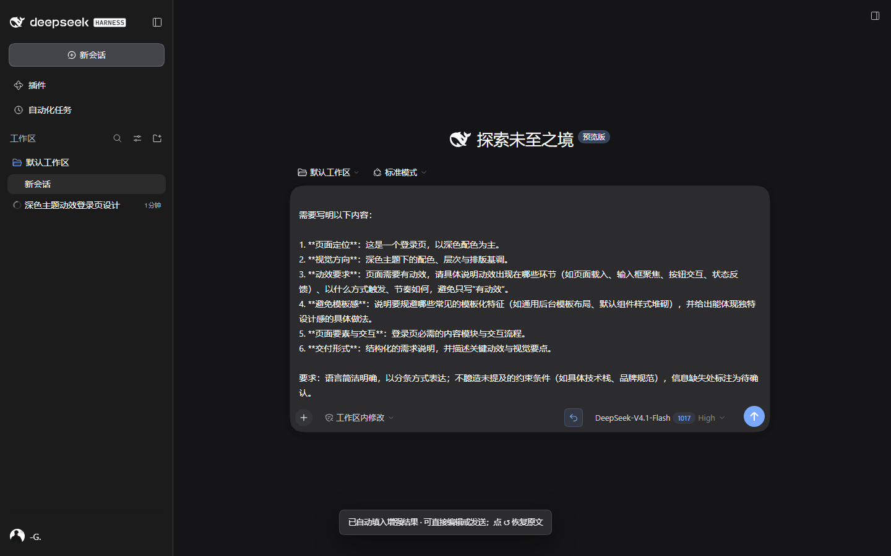

# dsh-prompt-enhance · 提示词增强

给 DeepSeek Harness 的会话输入框加一个「提示词增强」按钮：点一下，把随手写下的原始内容交给当前默认模型改写成更清晰、具体、结构完整的提示词，**直接自动填入输入框**；按钮随即变成「撤回优化」，点一下即可恢复增强前的原文。



## 交互

1. 在输入框写下内容，点模型选择器左边的 ✨。
2. 生成期间按钮变为三点波纹，不再使用旋转动画；再点一次可取消。
3. 生成完成后，结果自动填入输入框并聚焦在末尾，可以直接编辑或发送。
4. 按钮同时变成「撤回优化」↺：点击恢复增强前的原文。
5. 一旦你编辑、清空或发送了输入框内容，按钮自动回到 ✨（撤销记录失效），保证按钮状态与输入内容一致。

| 状态 | 按钮 | 说明 |
| --- | --- | --- |
| 空闲 | ✨ | 有内容时可点；空输入只提示 |
| 生成中 | 三点波纹 | 再点 = 取消；按钮有柔和的呼吸光晕 |
| 已填入 | ↺ | 仅在输入框内容仍等于刚填入的增强结果时显示 |





## 设计细节

- **动画**：三点依次起伏（1.25s、错峰 0.17s），按钮背景轻微呼吸；不旋转、不闪烁。尊重 `prefers-reduced-motion`，系统开启减少动态效果时只保留静态三点。
- **自动填入**：使用宿主官方 `inputActions.setDraft()`，不绕过编辑器、不接管发送链路；发送仍走原来的 Enter / 发送按钮。
- **状态联动**：撤销图标由「当前草稿是否等于刚填入的增强结果」推导，不是独立的开关。编辑、清空、发送、切换会话都会让按钮回到 ✨；切换会话还会中止在途请求。
- **不抢改动**：生成期间如果你继续编辑，结果不会覆盖新内容，只提示“输入内容已变化，本次结果未填入”。
- **语言与内容**：跟随输入语言；代码、命令、路径、URL、`@` 引用、`/` 命令、变量名、数字与特殊符号原样保留；不编造用户没提供的信息。
- **模型**：使用 profile 的默认模型（`agentDefaultModel.currentSelection()`），与本机新建会话一致。

## 边界处理

| 场景 | 行为 |
| --- | --- |
| 空输入 / 只有空白 | 按钮可点，但只提示「先输入内容」，不发请求 |
| 超长输入（> 20000 字符） | 客户端先拦下并提示当前字符数；宿主端有同样的硬上限，绝不静默截断 |
| 特殊字符 / 多行 / Markdown | JSON 传输 + React 纯文本渲染；换行、`<b>`、反斜杠路径等原样保留 |
| 生成中 | 三点波纹；再次点击取消（中止 fetch 与上游模型请求） |
| 生成期间草稿被改动 | 不自动填入，提示重试；草稿不受影响 |
| 模型/网络失败 | 底部 toast 显示具体错误，草稿保持不变 |
| 填入后手动编辑/清空/发送 | 撤销图标自动消失，回到 ✨ |
| 引用芯片 | 替换后文件/文件夹/会话引用会变成纯文本；图片/文件附件不受影响 |
| 超时 | 宿主 120s 中止上游请求，返回 504；客户端 135s 兜底 |
| 宿主没有默认模型 / 路由未注册 | 返回明确的 `NO_MODEL` / 网络错误提示 |

## 安装

### 方式一：dsh 插件命令（推荐）

```bash
dsh plugin --profile desktop add link:F:/开发/dsh-prompt-enhance/plugins/dsh-prompt-enhance
```

命令会把依赖写进 profile、并把声明了 `dsh.bundle` 的包自动并入 `dsh.profile.bundles`。

- **Host 半侧**：运行中的 profile 会由 HMR 自动重构，路由立即注册（`GET /dsh-prompt-enhance/status` 返回 `401` = 路由已注册，`404` = 未加载）。
- **浏览器半侧**：前端插件清单在页面加载时组装，装完或更新后请 **刷新页面（Ctrl+R）**。

### 方式二：手工挂载

1. 在 profile 的 `node_modules` 下建立目录联接：

   ```cmd
   mklink /J "%USERPROFILE%\.dsh\profiles\desktop\node_modules\dsh-prompt-enhance" "F:\开发\dsh-prompt-enhance\plugins\dsh-prompt-enhance"
   ```

2. 在 `%USERPROFILE%\.dsh\profiles\desktop\cordis.patch.yml` 末尾追加：

   ```yaml
   - insert:
       - id: dsh-prompt-enhance
         name: dsh-prompt-enhance
   ```

3. 刷新页面；必要时重启 DeepSeek Harness。

> 不要在 profile 的 `cordis.patch.yml` 里重复插入已经由 `dsh.profile.bundles` 选中的条目，否则同一路由会注册两次而报错。

## 结构

```
dsh-prompt-enhance/
  package.json           dsh.bundle / dsh.client 声明
  cordis.patch.yml       bundle 层：插入 Host 插件
  lib/index.js          Host 半侧：HTTP 路由 + ctx.llm 流式改写
  lib/client.js          浏览器半侧：按钮 + 自动填入 + 撤回（手写 ModuleLoader bundle）
  test/smoke-host.mjs    Host 逻辑冒烟测试（无依赖，node 直接跑）
  docs/                  截图
```

## 接口

| 方法 | 路径 | 说明 |
| --- | --- | --- |
| `GET` | `/dsh-prompt-enhance/status` | 诊断：插件版本、默认模型、输入/输出上限 |
| `POST` | `/dsh-prompt-enhance/enhance` | 请求体 `{ text, sessionId? }`，返回 `{ ok, text, unchanged, model, finish, elapsedMs }` |

两条路由都会先经过宿主 `connection.requestRejection()` 的浏览器信任栅栏；只监听本机回环地址。

Host 侧不 import 任何 `@deepseek-ai/*` 包，只使用 `ctx.llm.stream` 的公开协议（`text-delta` / `finish`），避免第三方插件的模块解析差异。

## 验证

```bash
node test/smoke-host.mjs
```

覆盖：空输入、超长输入、非法 JSON、正常改写（含代码围栏与“增强后的提示词：”前缀清理）、模型失败映射、空结果回退、路由释放。

端到端在隔离 profile（独立 `DSH_HOME`、Web profile、同一个 `deepseek-account` 默认模型）上用无头 Chromium 验证过：

- 生成中按钮显示三点波纹，计算样式确认无旋转动画；完成后自动填入，按钮变为 ↺；
- 点击 ↺ 恢复原文，按钮回到 ✨；
- 填入后手动编辑草稿，按钮立刻回到 ✨；清空/发送后同样回到 ✨；
- 发送出去的内容与填入的增强结果一致（换行未破坏），发送链路与原生一致；
- 空输入、20001 字符、生成中取消均不影响草稿。

## 已知限制

- 撤销图标只在输入框内容仍等于刚填入的增强结果时出现；一旦手动编辑，本次撤销记录即失效（避免覆盖你的修改）。
- 结构化引用（文件/文件夹/会话芯片）在替换后降级为纯文本；附件 id 不受影响。
- 增强结果使用默认模型，不读取当前会话里临时切换的模型；如需固定其它模型，可在 Host 侧改 `readDefaultRoute()`。
