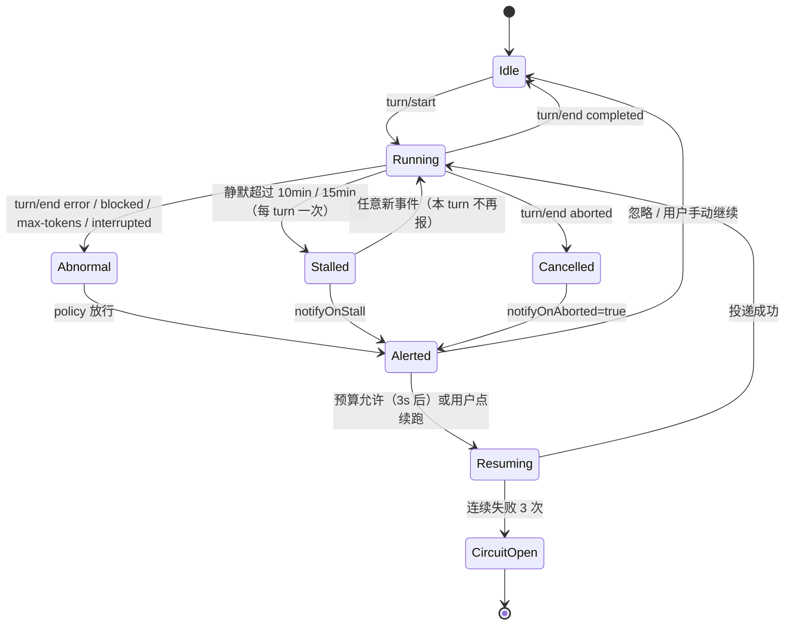

# 会话哨兵（dsh-session-watchdog）设计说明

> 版本 0.3.0 ｜ 目标宿主：DeepSeek Harness Desktop **0.2.2-rc.1** ｜ 2026-11-06
> 读者：使用插件的用户（第 1、3 章为主）与后续维护的开发者（其余章节）。
> 事实来源（插件根目录）：`research/01-session-lifecycle.md`、`research/02-ui-alert.md`、`research/03-packaging.md`（下称 01/02/03）。
> 证据写法：`01§3.1` = 01 报告第 3.1 节；`dsh-agent-loop:ReactLoopAgent.turn` = asar 内 `@deepseek-ai/dsh-agent-loop/lib/index.js` 的符号（asar 根 = `...\resources\app.asar\dsh\node_modules\@deepseek-ai\`）。未核实的标【待验证】，未实现的标【未实现】。

## 1. 它解决什么问题

DSH 没有"会话停止/出错"这类会话级事件：运行态挂在 Agent 上（`dsh-agent-loop:ReactLoopAgent.status` 只有 `idle|running`），一次 turn 是否正常结束，只能从会话事件流的 `turn/end` 与其 `reason.kind` 读出来（01§0-1、§2.6、§3.1 `TurnEndReasonMap`）。长任务卡死时连 `turn/end` 都没有，日志里只剩一个未闭合的 `turn/start`。

会话哨兵做三件事：

1. **判定**：订阅会话事件流，判断每个 turn 是正常完成、异常停止、被中止，还是长时间无响应（第 4 章）；
2. **提醒**：用页面卡片、侧栏徽标、系统通知、日志四条通道告知用户，并提供"一键续跑/忽略"（第 5 章）；
3. **续跑**：预算与熔断允许时，把从事件流**确定性提取**的断点上下文拼成中文指令，走与 GUI 发消息相同的路径投递（第 6、7 章）。

明确不做：不改会话内容、不往会话里插"系统提醒"消息（无公开 API，见 §5.4）；不评价回答质量；不做定时任务/成本统计；不在 Electron 主进程弹通知（宿主插件跑在独立 Node 子进程，`require('electron')` 必失败，02§3c）。

## 2. 形态、模块与数据流

### 2.1 一个包，两个半侧

| 半侧 | 入口 | 运行位置 | 职责 |
|---|---|---|---|
| 宿主半侧 | `lib/index.js`（`package.json` 的 `main`） | Host Node 子进程 | 事件订阅、停止判定、策略、上下文提取、续跑、状态落盘、HTTP 路由 |
| 浏览器半侧 | `lib/client.js`（`exports["./client"]`） | Web 前端 | 轮询宿主路由、提醒卡片、侧栏徽标、系统通知 |

宿主半侧是普通 Cordis 插件：`export const name` + `export const inject = []` + `apply(ctx, config)`，可选服务全部用 `ctx.inject` 惰性获取（与 `dsh-checkup` 同形态，03§1.4）。第三方插件不能 `import '@deepseek-ai/*'` 核心包，一切能力从 `ctx` 取（01§0-12）。浏览器半侧不是 ESM，必须用 `window.__ModuleLoader__.load({id, factory})` 注册工厂，且 `id` 必须等于包名（02§2.3；loader 解析见 `dsh-client-modules:parseDshClient`）。

### 2.2 模块职责

| 文件 | 职责 | 关键符号 |
|---|---|---|
| `lib/index.js` | 宿主入口：装配、事件订阅、判定后续处理、启动恢复/扫描、路由、退出清理 | `apply`、`handleDecision`、`scheduleResume`、`executeResume`、`startupScan`、`supersedePending` |
| `lib/detector.js` | 停止判定状态机（纯逻辑，只吃会话事件与时间） | `createDetector`（`observe/tick/restore/persistable`）、`TURN_END_KINDS`、`DEFAULT_STALL_TIMEOUT_MS` |
| `lib/policy.js` | 配置归一化；提醒/续跑决策；预算、熔断、去重 | `DEFAULT_CONFIG`、`normalizeConfig`、`createPolicy`（`decide/recordResult`） |
| `lib/context.js` | 断点结构化提取 + 真实对话原文摘录 | `extractContext`、`extractConversation`、`KIND_LABELS` |
| `lib/resume-instruction.js` | 依据真实内容生成续跑指令：llm / context 双模式、失败回落、简报与摘要 | `buildHandoffBrief`、`generateResumeInstruction`、`buildInstructionSummary` |
| `lib/runner.js` | 投递：`sessionController.prompt` 优先，`agent.followup` 兜底 | `createRunner`（`deliver/resolveAgent`）、`buildUserMessage` |
| `lib/notify.js` | 提醒事件流 + 四条 HTTP 路由（config 读写 / alerts / action） | `createFeed`、`registerRoutes`、`configPayload` |
| `lib/store.js` | 状态原子持久化（临时文件 + rename） | `createStore`（`load/schedule/flush/dispose`） |
| `lib/config-store.js` | 运行时配置：覆盖 > patch 静态 config > 默认值；白名单校验、原子写、即时生效 | `createConfigStore`（`update/reset/payload`）、`EDITABLE_FIELDS` |
| `lib/client.js` | 浏览器半侧：轮询、卡片、徽标、通知、**设置面板**、**完成提示音**、排障入口 | `window.__dshSessionWatchdog` |

### 2.3 一次异常停止的数据流

1. `ctx.on('session/event', (session, event) => ...)` 收到 `turn/end`（两参数同步签名，01§2.1）→ `detector.observe` 折叠事件并产出判定，id 形如 `sessionId#turn#kind`。
2. `index.handleDecision` 先做启动判定的二次校验，再交给 `policy.decide`（去重/范围/预算/熔断/安全检查）。
3. 放行后 `context.extractContext` + `buildResumePrompt` 生成指令，`feed.push` 一条 alert（浏览器可见）。
4. 若 `verdict.resume`，`scheduleResume` 挂 3 秒定时器（可被用户手动继续撤销）。
5. 到期 `runner.deliver`：`sessionController.prompt({mode:'queue'})`，失败退回 `agent.followup`。
6. 结果回写 alert 的 stage（resuming / resumed / resume-failed）并 `policy.recordResult`，随后立即落盘。
7. 浏览器每 1.5s（可见）/5s（后台）拉 `GET /alerts?since=<cursor>` → 卡片 + 徽标 + 系统通知；点按钮 `POST /action`。

### 2.4 安装与加载

- `package.json` 必须有 `dsh.bundle.patch`；有 UI 时才需要 `exports["./client"]` 与 `dsh.client.platform:"web"`（03§1.2）。
- `cordis.patch.yml` 只有一条 `- insert:`，其中 `id` 自定、`name` 与包名一致；`config` 就是 `apply(ctx, config)` 的第二个参数（03§1.3）。**patch 里的 config 是整块替换、不是深合并**（03§5.4）。
- 开发期安装：`& $dsh plugin --profile desktop add "link:F:\开发\Dsh-chajian\dsh-session-watchdog"`，其中 `$dsh` = `C:\Users\Administrator\AppData\Local\Programs\DeepSeek Harness\resources\runtime\cli\bin\dsh.cmd`（`dsh` 不在 PATH，03§2.1、§2.3）；HMR 会覆盖 profile 内（含 link 目标）的文件改动，但首次安装建议先退出桌面版（03§3.1）。
- 只验证"能不能被加载"时用临时 web profile 起独立进程：`--profile swtest --from-default-profile web` → `plugin add link:<目录>` → `--profile swtest --no-open --port 8099`（03§3.2）；纯干跑用 `--patch <yml> --dump-config`（03§3.4）。

## 3. 监控范围

### 3.1 根会话判据

- 权威判据是 `session.header.origin === 'subagent'`（01§1.4；宿主自己的 `dsh-api-session-controller:hasApiSessionSubagentOwner` 也只用它）。
- `parentSession` 不能单独当判据：普通 fork 也会写这个字段；`delegationDepth > 0` 是补充（01§1.4-2/3）。
- 实现：`detector.observe` 第一次见到会话时从 `session.header` 记录 `origin/cwd`，判定里带 `origin`；`policy.decide` 对 `origin==='subagent'` 且 `monitorSubagents=false` 直接返回 `reason:'subagent'`。

### 3.2 默认全量，可 include/exclude

| 配置 | 语义 |
|---|---|
| `includeCwd` | 非空时只监控这些目录（前缀匹配）；不在列表内一律不提醒 |
| `excludeCwd` | 排除这些目录及其子目录 |
| `excludeSessionIds` | 按会话 id 排除 |
| `monitorSubagents` | 是否把子代理会话也纳入（默认否） |

目录比较会归一斜杠、大小写和尾斜杠（`policy.js:samePath`），适配 Windows。**按标题过滤尚未实现**（只有 cwd 与会话 id），见第 11 章。

### 3.3 进程级：启动时补判上次未闭合的 turn

判定来源有两种：① 状态文件（本插件自己记录的未闭合 turn，`source='startup'`，默认**会**按策略续跑）；② 启动扫描（`sessionQuery` 读到的历史遗留未闭合 turn，`source='startup-scan'`，默认**只提醒不续跑**，需 `resumeOnStartupScan: true` 才续跑，避免首次安装惊动旧会话）。

两条互补路径：

1. **自己的状态文件**：`store.load` → `detector.restore(saved.detector, {savedAt})`。上次进程退出时 `openTurn !== null` 的会话 → `interrupted`（错误码 `HOST_EXIT`），启动 3 秒后补发（`STARTUP_DELAY_MS`）。
2. **磁盘兜底扫描**：`startupScan` 在启动 8 秒后跑一次。`ctx.sessionQuery.listSessions()` 列出全部逻辑会话且不激活它们（01§1.6）→ 只用 `persisted && !live`、最多 30 个 → `readSession(id)` 折 `turn/start|turn/end` → 存在未闭合 turn 且最后事件在 24 小时内 → `interrupted`（`CRASH_LEFTOVER`）。这条路覆盖"插件首次安装 / 状态文件丢失"。

两条路都要过二次校验：`savedAt` 距今 < 10 秒不报（避免刚启动就误报）；live Agent 仍 `running`、或 `ctx.agents.turnBoundaryOf(session).openTurnStartSeq !== null` 时不报（`dsh-agent:turnBoundaryOf`，01§1.2）。

> 局限：宿主**正常退出**也可能漏写最后的 `turn/end`（agent-loop README 已知限制，01§3.7），所以冷会话只能"未闭合即报"，可能多报一次；结合 `savedAt/lastEventAt` 只能降低、不能消除误报，用户可忽略。

### 3.4 明确不监控的对象

| 对象 | 处理 | 依据 |
|---|---|---|
| 子代理会话（`origin=subagent`） | 默认不提醒、不续跑；可配置纳入 | 01§1.4 |
| 后台 job / 定时任务 | `job/registered`、`job/settled` 不是 turn 边界；job 还在跑不代表 turn 活着，也不单独提醒 | 01§3.6 |
| 已销毁/删除的会话 | `session/disposed` 时 `detector.forget`，内存状态清空 | 01§1.5 |
| 已归档会话 | 不再产生新 turn；即便续跑也会被宿主 pre-step 拒绝成 `blocked`，由熔断收口 | 01§2.6 `installTurnArchiveAdmission` |
| 用户主动中止（`aborted/user`） | 默认静默（`notifyOnAborted=false`） | 01§3.2 |
| `completed` / `forked` 的 turn | 正常结束 / fork 合成原因，直接忽略 | 01§3.1 |

## 4. 停止判定（核心）

### 4.1 三条判定通道

| 通道 | 触发 | 判据 | 产物 kind |
|---|---|---|---|
| 事件通道 | `session/event` 里的 `turn/end` | `reason.kind`（7 种） | 原始 kind |
| 心跳通道 | 每 15 秒 `detector.tick()` | `running` + 未闭合 turn + 静默超阈值 | `stalled`（本地合成） |
| 启动恢复 | 启动后 3s / 8s | 状态文件里的 openTurn / 磁盘上未闭合的 turn | `interrupted` |

三条通道产出统一的 `decision`：`{id, sessionId, turn, kind, source, cancelCause, error, title, cwd, origin, awaitingUser, at}`（启动恢复额外带 `savedAt`，假死额外带 `stalledMs`）。后续策略、提醒、续跑都只消费这一种结构。

### 4.2 turn/end 分类矩阵

枚举原文来自 `TurnEndReasonMap`（01§3.1），由 `dsh-agent-loop:ReactLoopAgent.turn` 生成：

| reason.kind | 含义 | 默认提醒 | 默认续跑 | 依据 |
|---|---|---|---|---|
| `completed` | 正常收尾（模型结束/工具批次完成） | **是**（`notifyOnCompletion`，默认开；可关） | 否 | 01§3.1 |
| `error` | 模型/工具抛错，携带已序列化 `LlmFailure` | 是 | 是 | 01§3.1、§3.3 |
| `interrupted` | 进程中断；崩溃恢复时由 `interruptedTurnClosers` 补写 | 是 | 是 | 01§3.1、§3.7 |
| `max-tokens` | 输出触顶（优先级高于后续 completed） | 是 | 是 | 01§3.1 |
| `blocked` | 首步被 pre-step 拒绝（如归档/审批策略） | 是 | 是（风险见 §7.3） | 01§3.1、§3.4 |
| `aborted` | 取消，具体原因看 `reason.reason.kind` | 否（可开 `notifyOnAborted`） | 否 | 01§3.2 |
| `forked` | fork 边界合成原因 | 否 | 否 | 01§3.1 |
| 未知 kind | 兜底按失败处理（不当作成功） | 是 | 否 | 01§3.4 `accountsForClaim` |

> `max-tokens` 在 01§3.1 的生成规则里"不会被后续 completed 覆盖"；`blocked` 的 messages 会被丢弃（01§3.4），所以它需要提醒。

### 4.3 aborted 的四种取消原因

`TurnEndCancelCause`（01§3.2）：`user`（用户点停止）、`parent`（祖先取消）、`hook`（插件/hook 取消，带自由文本 `reason`）、`disposed`（宿主退出/卸载）、以及历史值 `legacy`。`detector` 把 `reason.reason.kind` 记进 `cancelCause`，续跑文案据此显示"用户主动停止/宿主退出"等。默认全部静默：`disposed` 是宿主生命周期事件，不应报成"任务失败"；`user/parent` 是用户意图。

### 4.4 假死心跳

- 每 15 秒 `detector.tick()`（`index.js:STALL_CHECK_INTERVAL_MS`）。
- 只检查 `status==='running' && openTurn!==null` 的会话。锚点 = `max(turnStartedAt, lastEventAt, 最新未关闭 tool/call 的 startedAt)`。
- 阈值：没有未完成工具时 **10 分钟**（`DEFAULT_STALL_TIMEOUT_MS`）；有未完成工具时 **15 分钟**（`DEFAULT_TOOL_STALL_TIMEOUT_MS`），避免误伤长构建/长命令。
- 每个 turn 只报一次（`stallReported`，在 `turn/start` 与 `turn/end` 复位）；id = `sessionId#turn#stalled`。
- 默认只提醒不续跑（`resumeOnStall:false`）。打开后允许在 Agent 仍 `running` 时投递：`followup()` 在 turn 运行中不报错，消息进 `inbox.nextTurn`（01§4.1），代价是可能和正在进行的工作重叠，故默认关。
- 任何会话事件都会刷新 `lastEventAt`，包括 `llm/retry`、`compaction/*`、`workspace/changes` 这类不产生判定的"杂音"，因此重试/压缩期间不会触发假死。

### 4.5 状态机

会话本身的持久状态只有 `unknown/running/idle` 三种（`detector` 内存态）；`Alerted/Resuming/CircuitOpen` 是提醒与策略的流转态，存在 alert 的 `stage` 与 `policy` 内部，不写回会话。

### 4.6 幂等键与去重

- 键格式：`sessionId#turn#kind`；`stalled` 用 `sessionId#turn#stalled`、启动恢复用 `sessionId#turn#interrupted`。这个字符串同时是 alert 的 `id`。
- 三层去重：① `policy.processed`，窗口 `dedupeWindowMs`（默认 10 分钟），`prune` 定期清理；② `policy.snapshot/restore` 随状态文件持久化，重启后不会重复续跑；③ 客户端 `toasted` Set 按 alert id 保证"同一事件只打扰一次"。
- alert 的 stage 推进会复用同一个 id（`detected → resuming → resumed/resume-failed/superseded/dismissed`），客户端只更新徽标，不重新弹卡片。

### 4.7 误报控制

- **等人不是停止**：`approval/asked` 未配对 `approval/decided` 时 `pendingApprovals>0`，判定带 `awaitingUser:true`；`skipWhenAwaitingUser=true` 时只提醒不续跑，心跳也不会把"等审批"报成卡死（`detector.js:approval/*`、`policy.js:decide`）。
- **长工具宽限**：未关闭的 `tool/call` 把阈值抬到 15 分钟，且其开始时间计入锚点。
- **压缩/重试不误判**：只有 `turn/end` 产生停止判定；`compaction/*`、`llm/retry*`、`assistant/attempt` 既不产生判定，又会刷新静默计时。
- **未知 kind 不当作成功**：与宿主 `accountsForClaim` 的保守口径一致（01§3.4）。
- **撤销**：`turn/start` 到达时清掉该会话尚未执行的续跑（`supersedePending`）；执行前再查一次 `lastEventAt > decision.at`。

## 5. 提醒

### 5.1 四条通道

| 通道 | 实现 | 触发条件 | 依据 |
|---|---|---|---|
| GUI 卡片 | `client.js` 自建固定浮层（直接挂 body，右上角，z-index 2147483000，最多 4 张 + 20 排队，`toastDurationMs` 自动消失、悬停暂停），带"续跑/忽略"按钮 | 任何被策略放行的提醒且 `notifyGui=true` | 02§3a；**不用**官方 `workspace.toast`（单值、半公开 API），也没有走 `shell.overlay` 槽 |
| 侧栏徽标 | 官方槽 `sidebar.session.row.trailing`（list + inline，条目给 `id/order`），红=异常、黄=续跑中、绿=已恢复，点击 `openSession` | 该会话存在未清除的 alert | 02§1.5、§6.1（槽条目只收到 `sessionId`） |
| 系统通知 | 页面内 `new Notification(title,{body,tag})`，仅当页面不可见（`document.hidden`）且 `notifyOs=true`；点击 `openSession` + `window.focus()` | 页面在后台 | 02§3c（**渲染进程**通知，不是 Electron main） |
| 日志/自检 | `ctx.logger.info/warn` + `GET /alerts` 流 + `window.__dshSessionWatchdog`（alerts/config/badges/cursor/poll） | 排障 | 03§4.1：桌面版没有可见 stdout，日志只在终端跑临时 profile 时可见 |

不改用 Electron main 通知的原因：Host 是 `spawn` 出来的独立 Node 子进程，`require('electron')` 必失败；向 Electron main 发自定义 IPC 会被 `isDesktopHostEvent` 判为非法并 SIGTERM 宿主（02§3c）。桌面主窗口是 `dsh-app://` 安全上下文，非媒体权限一律放行，所以页面内 `Notification` 是唯一正确的系统通知通道（同样来自 02§3c）。

### 5.2 宿主 ↔ 客户端契约（HTTP）

| 方法/路径 | 请求 | 响应 |
|---|---|---|
| `GET /dsh-session-watchdog/config` | 无 | `{ok:true, version, editable:[...], config:{全量配置}, defaults:{...}, updatedAt}`；`public` 里保留 `notifyOs/notifyGui/toastDurationMs` 兼容提醒卡片 |
| `POST /dsh-session-watchdog/config` | `{patch:{字段:值}}` 或 `{reset:true}` | 保存并**即时生效**，返回同 GET 的全量；只接受 `editable` 白名单字段，非法 patch 400、跨源 403；持久化到 `~/.dsh/session-watchdog/config.json` |
| `GET /dsh-session-watchdog/alerts?since=<cursor>` | 游标 | `{ok:true, cursor, alerts:[...]}`，按 cursor 增量；同一 alert 的 stage 变化会推进 cursor |
| `POST /dsh-session-watchdog/action` | `{id, action: resume 或 dismiss}` | `{ok:true, result}`；跨源 403、方法不对 405、请求体非法 400、上限 64 KiB |

alert 字段：`id / sessionId / title / kind / stage / reason / error / turn / at / resumeAt / resumeCount / summary`；执行结果追加 `via` 并更新 `stage`。客户端轮询节奏：可见 1500ms、后台 5000ms；请求失败指数退避（1.5s→3s→…→30s 封顶），单次超时 8s；超过 10 分钟的旧 alert 只更新徽标、不补弹（防止刷新后一次弹一堆）。

### 5.3 去重、静默、夜间免打扰

- 去重：宿主侧见 §4.6；卡片按 alert id 去重，系统通知 `tag = 'dsh-session-watchdog-' + alert.id`。
- 静默：`notifyGui=false` 不弹卡片（徽标仍更新）；`notifyOs=false` 不发系统通知；`notifyOnStall`、`notifyOnAborted` 在策略层就不产生提醒。
- 夜间免打扰：**未实现**。当前只有"页面隐藏才发系统通知"这一条降噪；22:00–08:00 静音需要新增配置项与客户端时段判断（建议字段 `quietHoursStart`/`quietHoursEnd`，当前不在 `DEFAULT_CONFIG` 中）【未实现】。

### 5.4 做不到：往会话里插一条"不触发模型"的系统提醒

结论：**没有公开 API**（02§3b）。证据：

- Remote 端点全量 27 个，写入路径只有 create/fork/prompt/rename/selectModel/updateQueue/cancel，没有"append notice"（`dsh-api-session-controller:typert.remote-client.js`）。
- 宿主 `session.append('developer/message', ...)` 能写，但它是 surface 事件，会进模型上下文（烧 token、可能影响行为），且冷会话写不进去（`dsh-session/README.md:44`）。
- `appendPluginRecord` 被官方明文禁止第三方调用（`dsh-session/README.md:72`），且不进模型可见 surface，达不到"用户可见提醒"。
- 因此提醒只走卡片/徽标/系统通知。若需要"下次打开会话还能看到"，只能写插件自己的持久区，再用会话视图的只读提示条呈现（未实现）。

### 5.5 设置面板（提醒开关 + 监控内容规则）

入口：DSH **设置 → 左侧「会话哨兵」**（客户端注册 `settings.section` 槽，order 510）。槽不可用或 React 不可用时静默跳过，不影响提醒卡片与徽标。

| 分组 | 可调项 |
|---|---|
| 提醒开关 | `notifyGui`（页面卡片）、`notifyOs`（系统通知）、`notifyOnAborted`（用户主动停止也提醒）、`notifyOnStall`（假死提醒）、`toastDurationMs`（卡片停留，秒） |
| 监控内容规则 | `enabled`（总开关）、`autoResume`、`monitorSubagents`、`skipWhenAwaitingUser`、`resumeOnStartupScan`、`resumeKinds`（error/interrupted/max-tokens/blocked 多选） |
| 监控范围 | `includeCwd` / `excludeCwd`（目录前缀，空=全部）、`excludeSessionIds`（chip 可增删） |
| 阈值与预算 | `stallTimeoutMs` / `toolStallTimeoutMs` / `resumeDelayMs`（面板按秒输入）、`maxResumesPerSession`、`globalBudget`、`maxConsecutiveFailures`、`maxContextChars` |

- **持久化与优先级**：`config.json` 的运行时覆盖 > `cordis.patch.yml` 的静态 `config` > 代码默认值；「恢复默认」清空运行时覆盖，回到 patch 配置。
- **即时生效**：保存后宿主原地更新配置对象（policy 持同一引用）、同步假死阈值（`detector.setOptions`），无需重启；`enabled=false` 时策略层直接拒绝提醒与续跑，但仍保持事件订阅（改回 true 立即恢复）。
- **安全**：写入路由做同源校验（跨源 403）、字段白名单（未知字段 400）、数值夹取（如假死阈值最小 30s）、请求体上限 64 KiB。
- **不做**：设置页不提供"中止会话/删除会话"等副作用操作；不写用户的 `cordis.patch.yml`（避免破坏注释与格式）。
- **真机验证（2026-11-06）**：在运行中的桌面版上 `dsh plugin --profile desktop add` 后，宿主半侧路由立即 200（HMR 热加载）；设置页左侧出现「会话哨兵」，四组渲染正常；面板里把「假死阈值」改成 601 秒保存后，宿主 `/config` 返回 `stallTimeoutMs=601000`，点「恢复默认」二次确认后回到 600000 且 `config.json` 的 `overrides` 为空。截图：`docs/preview/截图1-提醒开关.png` ~ `截图5-恢复默认.png`。

### 5.6 任务完成提醒与提示音（v0.3 新增）

> 卡片位置固定在**右下角**（从下往上堆叠）；卡片与系统通知里的会话名与会话列表完全一致：宿主优先用 `sessionTitle` 服务的标题，客户端再按 `sessions.list.byId[id].displayTitle` 兜底，任何情况下都不显示「未命名」。

- **触发**：`turn/end.reason.kind === 'completed'` 且 `notifyOnCompletion=true`（默认开）。完成提醒**永不自动续跑**，只做提醒。
- **提醒形态**：页面卡片（标题「任务完成」+ 会话标题 + 摘要，只有「忽略」按钮）、侧栏绿色完成徽标（30s 自清）、页面隐藏时的系统通知。
- **提示音**：内置 6 种合成音色（无音频文件依赖，Web Audio oscillator 包络）：`dingdong` 经典叮咚、`double` 清脆双击、`tritone` 轻快三连音、`drop` 水滴、`chime` 柔和小铃、`pulse` 电子脉冲；另有 `none` 关闭。设置面板可下拉选择、调整音量（`completionVolume`，0-100，默认 70），并可「试听」。
- **自动播放策略**：浏览器/Electron 渲染进程要求用户交互后才允许出声；客户端在首次 pointerdown/keydown 时解锁 AudioContext，未解锁时任务完成只弹卡片、不报错（下次交互后正常发声）。
- **去重**：同一 alert id 只播一次；`completionSound='none'` 或音量 0 时静音。
- **真机验证（2026-11-06）**：设置页实测出现「任务完成也提醒」「完成提示音（叮咚（双音）下拉 + 试听）」「提示音音量」三项；`GET /config` 返回 `notifyOnCompletion=true / completionSound=dingdong / completionVolume=70 / resumePromptMode=llm`。截图：`docs/preview/截图6-任务完成提醒与提示音.png`、`截图7-续跑指令生成方式.png`。

## 6. 上下文与续跑指令（依据会话实际内容生成）

### 6.1 真实内容来源

判定器为每个会话保留最近 400 条事件；生成指令时从同一份事件流取两类事实：

- **结构化事实**（`context.extractContext`）：最近一次 `todo/write` 的未完成待办、`goal/change` 当前目标、最后 `tool/call` 动作、最后失败（`tool/result.isError` 或 `turn/end.error`）、标题、cwd。
- **对话原文**（`context.extractConversation`，v0.3 新增）：最近 10 条 `user/message` / `assistant/message` 的真实文本（最多 2400 字，按时间从旧到新），以及每条消息是否来自插件源。
- **模型路由**（v0.3 新增）：从 `request/context` / `model/selection` 事件记录该会话实际使用的 `provider` / `model`，用于"用同一模型写续跑指令"。

### 6.2 两种生成模式（设置 → 续跑指令生成方式）

| 模式 | 行为 | token 成本 |
|---|---|---|
| `llm`（默认） | 把「交接简报」发给**该会话自己使用的 provider/model**，由模型写出承接上下文的续跑指令（≤400 字，要求引用真实文件/待办原文、说明不要重做的部分、给出验证方式、禁止套模板与编造） | 一次小请求（简报 ≤ ~3k 字 + 400 输出） |
| `context` | 不调用模型，直接用真实对话原文 + 待办 + 目标 + 错误拼成交接说明 | 0 |

两种模式都以真实内容为唯一事实来源，**不再使用固定话术模板**；旧 `buildResumePrompt` 仅保留兼容导出，主流程不再调用。

### 6.3 交接简报（两种模式共用的底稿）

~~~text
【会话交接记录】
会话：<title>｜工作目录：<cwd>
中断原因：<kindLabel>｜<error.message>
当前目标：<goal>
未完成待办（共 N 项，已完成 M 项）：
  1. <pending todo 原文> …
中断前最后动作：<toolName> <arguments>
最近一次失败：<message>（<code>）
最近对话原文（从旧到新）：
  [用户] <真实消息原文>
  [助手] <真实消息原文>
~~~

简报本身已经是"对应会话的实际内容"；`context` 模式在其后追加一句最小行动要求，`llm` 模式把它作为模型输入。

### 6.4 生成时序与失败处理

1. **判定时**只计算卡片摘要（`buildInstructionSummary`：真实待办数 / 错误码 / 中断原因），不生成完整指令——避免用户 3 秒内手动继续时话术过期。
2. **真正投递前**（`resumeDelayMs` 到点、且未被 `turn/start` 撤销）才生成：读取最新事件 → 简报 → `llm` 模式调模型 / `context` 模式拼装。
3. 模型调用：`ctx.llm.prepareCall({provider, model, maxTokens})` + `stream()`，只收集 `text-delta`；默认 20s 超时；输出清理代码围栏与首尾引号。
4. 以下情况**自动回落**上下文拼装，并在提醒流里标记 `instructionSource='context'` 与 `instructionError`：会话没有记录 provider/model、`ctx.llm` 不可用、`prepareCall` 抛错、流式输出为空/过短、超时。
5. 长度：模型输出截到 `resumeInstructionMaxChars`（默认 1200 字）。

### 6.5 安全与隐私

- 只使用该会话日志里已有的内容，不读工作区文件、不额外抓取屏幕；
- `llm` 模式使用会话自己的 provider，不把内容发给第三方服务；
- 切到 `context` 模式即零 token、零外发；
- 指令生成失败不影响续跑：回落模式仍然基于真实内容。

## 7. 续跑执行

### 7.1 三条投递路径（优先与 GUI 同路径）

1. **`sessionController.prompt`**（首选）：`{requestId, sessionId, mode:'queue', content:[{type:'text',text}]}` + `AbortSignal`（30s 超时）。与 GUI 发消息走同一条代码路径，自带冷会话唤醒；`mode:'queue'` 等价 `followup`（01§4.3 路径 2）。【待验证】插件上下文直调 Remote 边界方法（01§8-1），失败自动降级。
2. **`agent.followup`**（兜底）：`ctx.agents.get(id)` 取不到时先 `sessionController.resolveAgent(id)`（冷会话，01§4.2），再 `agent.followup(userMessage)`；消息由 `runner.buildUserMessage` 手搓，满足落盘校验四要素（id 非空、role:'user'、content 数组、source.kind，01§4.3 路径 1）。
3. **`agent.send(msg,'next-turn',true)`**：极老 Agent 的最后兜底。

> 冷会话还有更底层的 `ctx.agents.resume({resumeSessionId})`（01§4.2 路径 C），但它要自己 `setup` 模型与 preset，否则得到"裸 Agent"，与 GUI 里同一会话的行为不一致，本项目不采用。

投递后：followup 路径调用 `ctx.sessions.flush(agent.session)` 确认落盘（返回 boolean 表示是否存在持久化监听者，01§4.4）；prompt 路径的落盘由宿主的会话持久化链路负责（未单独 flush）。结果回写 `policy.recordResult`，并把 alert 标成 resumed / resume-failed + `via`。

### 7.2 续跑前 8 项安全检查

| # | 检查 | 实现 | 不满足时 |
|---|---|---|---|
| 1 | 会话存在且未归档 | 冷会话 `resolveAgent` 失败即放弃；归档状态**没有**宿主侧只读 API【待验证】，靠后续 `blocked` + 熔断兜底 | 投递失败并计入连续失败 |
| 2 | Agent 空闲（**不用于 turn/end 来源**） | `turn/end` 在 `ReactLoopAgent.turn` 的 `finally` 里同步 append，此时 phase 尚未切回 idle，读到的 `agent.status` 必然是 `running`——所以该检查只对显式传入状态的调用方生效，**不能**用来拦正常 turn 结束的续跑（§11 已解决项）；“用户已手动继续”由第 8 项 `turn/start` 撤销保证 | — |
| 3 | 无未决用户交互 | `awaitingUser`（未配对 `approval/asked`）→ `awaiting-user` | 只提醒 |
| 4 | cwd 存在 | `index.js:cwdUsable` → `fs.existsSync`；空 cwd 视为可用 | `cwd-missing`，只提醒 |
| 5 | 非子代理 | `origin==='subagent'` 且未开 `monitorSubagents` → `subagent` | 不提醒不续跑 |
| 6 | 预算未耗尽 | 会话预算 / 全局预算 | `session-budget` / `global-budget`，只提醒 |
| 7 | 幂等未触发 | `policy.processed` 已有该 id → `duplicate` | 直接丢弃 |
| 8 | 用户未手动继续 | `turn/start` 到达撤销待执行续跑；执行前再查 `lastEventAt > decision.at` | `superseded` |

另外 `autoResume=false` → `auto-resume-off`；kind 不在 `resumeKinds` → `kind-not-resumable`。所有拒绝原因都会写进 alert/log，方便现场判断"为什么没续跑"。

### 7.3 熔断与预算

- 每会话：`maxResumesPerSession=2` 次 / `resumeWindowMs=30min`；全局：`globalBudget=5` 次 / `globalBudgetWindowMs=10min`。
- 连续失败：`recordResult(sessionId,false)` 累加，达到 `maxConsecutiveFailures=3` 置 `blocked`（之后只提醒）；成功清零。`policy.clearSession()` 可解除熔断（目前没有 UI 入口，需要调内部 API）。
- 三个实现细节要知道：① 预算在 `decide` 时扣除，3 秒内被撤销**不退还**；② 客户端"手动续跑"走 `POST action=resume`，直接调 `executeResume`，**绕过**预算/熔断检查（失败仍计入连续失败）；③ 默认 `resumeKinds` 含 `blocked`，归档/审批策略拒绝的会话可能再被 blocked 一次，靠熔断收口——更保守可把它从列表移除。
- 未按 `LlmFailure.code` 过滤可重试性：QUOTA/INVALID_CREDENTIAL 这类错误也会消耗预算后再熔断（01§3.4 的 `isRetryable` 尚未接入）【待改进】。

### 7.4 3 秒延时与撤销

- `resumeDelayMs` 默认 3000（范围 [0, 60000]）；`setTimeout(...).unref()`，待执行项放在 `pending` Map（alertId → `{timer, decision, text}`）。
- 撤销条件：同会话 `turn/start`（用户手动继续）→ `supersedePending` 清定时器并把 alert 标 `superseded`；用户点"忽略" → `dismiss`；执行到时发现 `state.lastEventAt > decision.at` → 同样 superseded；插件卸载 → 清空全部待执行项。
- 到期后先 `feed.update(alertId,{stage:'resuming'})` 再投递，UI 立刻有反馈。

### 7.5 落盘

- `turn/end` 后立即 `store.flush`；续跑结果后也立即 flush；其余事件 1.5 秒 debounce。
- 状态 = `{version:1, savedAt, detector: persistable(), policy: snapshot()}`；只存必要字段（标题、cwd、origin、openTurn、时间、最后用户/助手文本各 ≤500 字符、pendingApprovals）。
- 宿主退出只有 **5 秒**硬上限（`PROCESS_SHUTDOWN_TIMEOUT_MS = 5e3`，01§6.4），所以不依赖退出钩子做异步落盘；`ctx.effect` 清理里只做同步 flush + 删除临时文件。
- 与"写一条落一条"的折中：普通事件 1.5s debounce，只有 `turn/end` 与续跑结果同步 flush；5 秒退出窗口内最多丢 1.5s 的中间态，turn 边界不会丢。

## 8. 异常处理与健壮性

- **自身异常隔离**：Cordis 的 `emit` 是"抛错即中断"，一个监听器同步抛异常会饿死其后的所有监听器（01§2.1，`dsh-session-telemetry:contain` 的注释明确说了）。因此 `session/event`、心跳、启动扫描、路由、`onAction` 全部整段 try/catch，失败只 `logger.warn`。
- **限流**：心跳 15s；启动扫描最多 30 个会话、24h 窗口；提醒流上限 200 条；客户端 1.5s/5s 轮询 + 指数退避；detector 每会话事件缓存 400 条、空闲 1h 淘汰。
- **持久化原子写**：`store.js` 先写 `.tmp` 再 `rename`，`unref` 定时器，`dispose` 时删临时文件；任何写失败只 warn，不拖垮宿主。
- **配置非法回落**：`normalizeConfig` 逐字段校验，类型错回落默认、数值夹到区间、未知字段透传（留给未来开关），**永不抛错**；`enabled=false` 时 `apply` 直接返回，零副作用。
- **通知权限被拒**：客户端置 `notificationsDenied`，永久降级为卡片 + 徽标，不反复申请权限（`client.js:prepareNotifications/maybeNotifyOs`）。
- **路由无鉴权**：`webServer.register` 本身没有鉴权（02§4.3）。GET 只读且不暴露敏感数据；POST 只接受同源 Origin（`notify.js:sameOrigin`），请求体上限 64 KiB，方法白名单。
- **热重载/禁用**：定时器、DOM 浮层、Notification、事件监听都挂在 `ctx.effect` 上，fiber 卸载统一清理；状态文件保留，重启后 `restore` 对账，不依赖 `dsh-hmr` 的内存事件（01§6.5）。
- **多实例**：没有跨进程锁。两个 Host 写同一个 `state.json` 会后写覆盖；路由重复注册会失败但被 try/catch 吞掉。**建议只跑一个桌面实例**；多实例行为未实测【待验证】。
- **可选服务缺失**：宿主半侧的 `sessionController` / `webServer` 与浏览器半侧的 `slots` 都用 `ctx.inject` 惰性获取；没有就降级（无路由 → 客户端 404 静默退避；无徽标槽 → 只留卡片），不阻断页面与宿主启动。

## 8.1 可选宿主服务必须用 ctx.get 读取（v0.3.1 修复）

Cordis 上下文对**未在 inject 声明的服务属性直读**会抛 `cannot get property "<name>" without inject`；
插件是 `inject = []` 的可选增强，因此 `llm / agents / sessions / sessionQuery` 一律通过
`ctx.get(name)`（不需要 inject）读取，且续跑流程整体 try/catch —— 否则一次续跑就能让宿主
`fatal load failure` 退出（v0.3.0 真机实测，详见 `docs/02-实现方案.md` §10）。

## 9. 配置项总表

默认值来自 `policy.js:DEFAULT_CONFIG`；优先级 **运行时配置 `~/.dsh/session-watchdog/config.json` > `cordis.patch.yml` 的静态 `config` > 代码默认值**。`cordis.patch.yml` 的 `config` 是整块替换（03§5.4），改任一字段时要把其余字段重述；设置面板（§5.5）只写 config.json，不动 patch 文件。下表 22 个标记「可」的字段都可在设置面板改。

| 字段 | 类型 | 默认 | 含义 |
|---|---|---|---|
| `enabled` | boolean | true | 总开关；false 时 `apply` 直接返回 |
| `autoResume` | boolean | true | 是否自动续跑（false 时只提醒） |
| `resumeKinds` | string[] | error / interrupted / max-tokens / blocked | 允许续跑的判定 kind |
| `monitorSubagents` | boolean | false | 是否监控子代理会话 |
| `includeCwd` | string[] | [] | 白名单目录（非空时只监控这些及其子目录） |
| `excludeCwd` | string[] | [] | 排除目录及其子目录 |
| `excludeSessionIds` | string[] | [] | 排除的会话 id |
| `notifyOnStall` | boolean | true | 假死是否提醒 |
| `notifyOnCompletion` | boolean | true | 任务正常完成是否提醒（完成永不自动续跑） |
| `completionSound` | string | dingdong | 完成提示音：none/dingdong/double/tritone/drop/chime/pulse |
| `completionVolume` | number | 70 | 提示音音量（0-100） |
| `resumePromptMode` | string | llm | 续跑指令生成方式：llm=模型依据真实内容生成，context=上下文摘录拼装 |
| `resumeLlmTimeoutMs` | number | 20000 | 生成续跑指令的模型调用超时（[1s, 60s]） |
| `resumeLlmMaxOutputTokens` | number | 500 | 生成续跑指令的输出上限（[64, 2000]） |
| `resumeInstructionMaxChars` | number | 1200 | 生成结果长度上限（[200, 4000]） |
| `notifyOnAborted` | boolean | false | 用户/父级/hook 中止是否提醒 |
| `resumeOnStall` | boolean | false | 假死是否自动续跑 |
| `stallTimeoutMs` | number | 600000 | 无未完成工具的静默阈值（夹到 [30s, 6h]） |
| `toolStallTimeoutMs` | number | 900000 | 有未完成工具的静默阈值（[30s, 6h]） |
| `resumeDelayMs` | number | 3000 | 续跑延时（[0, 60s]） |
| `dedupeWindowMs` | number | 600000 | 幂等窗口（[0, 24h]） |
| `maxResumesPerSession` | number | 2 | 每会话续跑预算（[0, 50]） |
| `resumeWindowMs` | number | 1800000 | 每会话预算窗口（[1min, 24h]） |
| `globalBudget` | number | 5 | 全局续跑预算（[0, 200]） |
| `globalBudgetWindowMs` | number | 600000 | 全局预算窗口（[1min, 24h]） |
| `maxConsecutiveFailures` | number | 3 | 连续失败熔断阈值（[1, 20]） |
| `skipWhenAwaitingUser` | boolean | true | 等用户审批/回答时不续跑 |
| `notifyOs` | boolean | true | 系统通知开关（下发给客户端） |
| `notifyGui` | boolean | true | 页面卡片开关（下发给客户端） |
| `toastDurationMs` | number | 8000 | 卡片停留时长（[2s, 60s]） |
| `maxContextChars` | number | 2000 | 续跑指令长度预算（[400, 20000]） |
| `resumePromptHeader` | string | [会话哨兵] | 续跑指令抬头 |
| `resumeOnStartupScan` | boolean | false | 启动扫描到的“历史遗留未闭合 turn”是否也自动续跑；默认只提醒，避免首次安装时惊动旧会话 |
| `stateFile` | string | 未列出 | 状态文件绝对路径；默认 `~/.dsh/session-watchdog/state.json`（透传字段，不参与策略；配置文件固定在同目录 `config.json`） |

不可配置的固定值：心跳 15s；启动补发延时 3s；启动扫描延时 8s、回溯 24h、最多 30 个、新鲜度门槛 10s；提醒流上限 200 条；每会话事件缓存 400 条；客户端轮询 1500/5000ms、退避上限 30s、卡片最多 4 张、旧 alert 阈值 10min。

## 10. 性能与隐私

- **只读**：插件不 append 会话事件、不改会话文件；唯一的"写"是续跑消息（可关 `autoResume`），`ctx.sessions.flush` 只是持久化屏障（01§4.4）。停止判定完全被动监听。
- **零 token / 零外发**：上下文提取是纯本地字符串处理；插件不发起外部网络请求，客户端 `fetch` 只访问同源本地路由；无遥测。
- **状态文件**：默认 `~/.dsh/session-watchdog/state.json`，含会话标题、cwd、最后用户/助手文本各 ≤500 字符——**敏感内容会落盘**，仅本机；删除该文件即清空哨兵记忆，不卸载插件时建议限制文件权限。
- **开销**：每事件 O(1) 折叠 + 最多 400 条环形缓冲；15s 心跳 O(会话数)；客户端每 1.5s 一次几百字节的本地 HTTP；不读会话历史文件（启动扫描除外，最多 30 个、一次性）。

## 11. 限制与未验证项

| # | 事项 | 现状 / 建议 |
|---|---|---|
| 1 | ~~`turn/end` 时 Agent 可能仍是 `running` 导致续跑被拦~~ | **已修复**：`policy.decide` 不再用 `agentStatus` 拦截 turn/end 来源（只保留 `turn/start` 撤销与投递排队语义）；补了策略单测 + 集成回归（“agent.status=running 仍能续跑”），见 §11 测试证据 |
| 2 | 页面 `new Notification()` 在本机 Windows 是否真弹 toast | 未实测（02§7-1：主进程未设 AppUserModelID，代码路径支持）。上线前先发一条 probe 通知 |
| 3 | `sessionController.prompt` 插件内直调 | 未冒烟（01§8-1，Remote 边界方法）；有 `followup` 兜底，但冷会话唤醒语义需实测 |
| 4 | 按标题过滤 | 未实现，目前只有 cwd 与会话 id |
| 5 | 可重试性过滤 | 未实现，按 `LlmFailure.code` 区分可重试尚缺（01§3.4 `isRetryable`） |
| 6 | 宿主正常退出漏写 `turn/end` | 可能误报一次 `interrupted`（01§3.7）；只能靠 `savedAt/lastEventAt` 降低 |
| 7 | 归档状态 | 宿主侧无只读 API；"未归档"检查靠续跑失败 + 熔断兜底【待验证】 |
| 8 | 夜间免打扰 | 未实现；只有"页面隐藏才发系统通知" |
| 9 | 会话内留痕 | 无公开 API（02§3b），做不到"不触发模型的系统消息" |
| 10 | alerts 流不落盘 | 宿主重启后历史提醒消失；detector/policy 状态有持久化，alert 流没有 |
| 11 | ~~设置面板未真机截图验证~~ | **已验证**（2026-11-06，desktop profile 运行中直接 `dsh plugin add` 热加载）：设置 → 会话哨兵 四组全部渲染；截图见 `docs/preview/截图1~5`；保存/恢复默认走 `dsh-app://` 同源请求均成功 |
| 12 | `config.json` 无跨实例锁 | 桌面版与独立 web 实例同时运行会各写各的（原子 rename，最后写胜出）；建议只保留一个实例 |
| 13 | 提示音依赖渲染进程自动播放策略 | 首次交互前完成提醒可能只弹卡片不出声（Electron 策略）；设置里「试听」一次即可解锁 |
| 11 | 多实例 | 无文件锁；两个 Host 共写 `state.json` 会互相覆盖【待验证】 |
| 12 | `workspace/changes` | 未纳入上下文提取（原设计提及） |
| 13 | 浏览器半侧 | 槽/Notification/自定义浮层未在真实桌面端跑通验证；现场排障用 `window.__dshSessionWatchdog` |
| 14 | 假死判定只看会话事件 | 不看 `agent/assistant-stream` 的 chunk（01§2.7），超长流式生成理论上可能误报；阈值 10min 可调 |
| 15 | 启动扫描覆盖面 | 只覆盖 `persisted && !live`、最后事件 24h 内、最多 30 个会话 |

验证通道：纯逻辑与假 ctx 集成测试用 `node --test test/*.test.mjs`（Node ≥22.19 即可；本机系统 22.23.4、宿主随装 24.21.0，03§0/§3.6）；加载/打包用 `--dump-config` 干跑与临时 web profile（03§3.4、§3.2）；真机行为（通知、续跑、冷会话）必须在本机桌面版冒烟。
